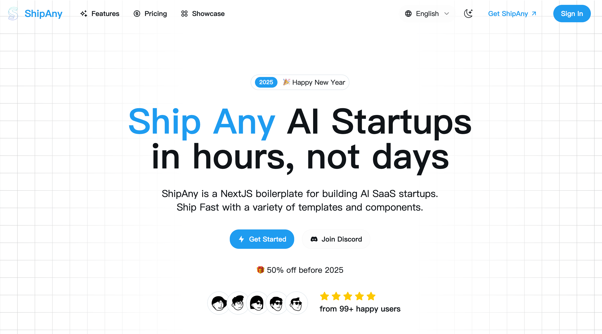

# ShipAny Template One

Ship Any AI SaaS Startups in hours.



## Quick Start

1. Clone the repository

```bash
git clone https://github.com/shipanyai/shipany-template-one.git
```

2. Install dependencies

```bash
pnpm install
```

3. Run the development server

```bash
pnpm dev
```

## Customize

- Set your environment variables

```bash
cp .env.example .env.development
```

- Set your theme in `src/app/theme.css`

[tweakcn](https://tweakcn.com/editor/theme)

- Set your landing page content in `src/i18n/pages/landing`

- Set your i18n messages in `src/i18n/messages`

## Deploy

- Deploy to Vercel

[](https://vercel.com/new/clone?repository-url=https%3A%2F%2Fgithub.com%2Fshipanyai%2Fshipany-template-one&project-name=my-shipany-project&repository-name=my-shipany-project&redirect-url=https%3A%2F%2Fshipany.ai&demo-title=ShipAny&demo-description=Ship%20Any%20AI%20Startup%20in%20hours%2C%20not%20days&demo-url=https%3A%2F%2Fshipany.ai&demo-image=https%3A%2F%2Fpbs.twimg.com%2Fmedia%2FGgGSW3La8AAGJgU%3Fformat%3Djpg%26name%3Dlarge)

- Deploy to Cloudflare

for new project, clone with branch "cloudflare"

```shell
git clone -b cloudflare https://github.com/shipanyai/shipany-template-one.git
```

for exist project, checkout to branch "cloudflare"

```shell
git checkout cloudflare
```

1. Customize your environment variables

```bash
cp .env.example .env.production
cp wrangler.toml.example wrangler.toml
```

edit your environment variables in `.env.production`

and put all the environment variables under `[vars]` in `wrangler.toml`

2. Deploy

```bash
npm run cf:deploy
```

## Community

- [ShipAny](https://shipany.ai)
- [Documentation](https://docs.shipany.ai)

## License

- [ShipAny AI SaaS Boilerplate License Agreement](LICENSE)

## API 多语言支持

### 支持的语言
- 英文 (en) - 默认语言
- 中文 (zh)

### 使用方法

在调用API时，可以通过 `locale` 参数指定语言：

#### 单图片分析 - `/api/analyze`
```javascript
const formData = new FormData();
formData.append('file', imageFile);
formData.append('locale', 'zh'); // 或 'en'

const response = await fetch('/api/analyze', {
  method: 'POST',
  body: formData
});
```

#### 多图片分析 - `/api/analyze-multiple`
```javascript
const formData = new FormData();
formData.append('fileCount', files.length.toString());
files.forEach((file, index) => {
  formData.append(`file${index}`, file);
});
formData.append('locale', 'zh'); // 或 'en'

const response = await fetch('/api/analyze-multiple', {
  method: 'POST',
  body: formData
});
```

#### 流式分析 - `/api/analyze-stream`
```javascript
const formData = new FormData();
formData.append('file', imageFile);
formData.append('locale', 'zh'); // 或 'en'

const response = await fetch('/api/analyze-stream', {
  method: 'POST',
  body: formData
});
```

### 语言自动检测

如果未指定 `locale` 参数，API会：
1. 默认使用英文 (en)
2. 对于某些错误情况，会检查请求头中的 `accept-language` 进行自动检测

### AI 分析结果

根据指定的语言，AI会返回相应语言的分析结果：
- 评分类别
- 优势分析
- 改进建议
- 照片建议
- 个人资料建议

### 错误消息

所有错误消息也会根据指定的语言返回相应的翻译版本。

## 健康检查

可以通过以下端点检查API状态和支持的语言：

```bash
GET /api/analyze
GET /api/analyze-multiple
```

响应示例：
```json
{
  "status": "healthy",
  "service": "lucylucy-analyze-api",
  "version": "3.0.0",
  "features": ["openai-vision", "real-ai-analysis", "streaming-support", "multilingual-support"],
  "supportedLocales": ["en", "zh"]
}
```
